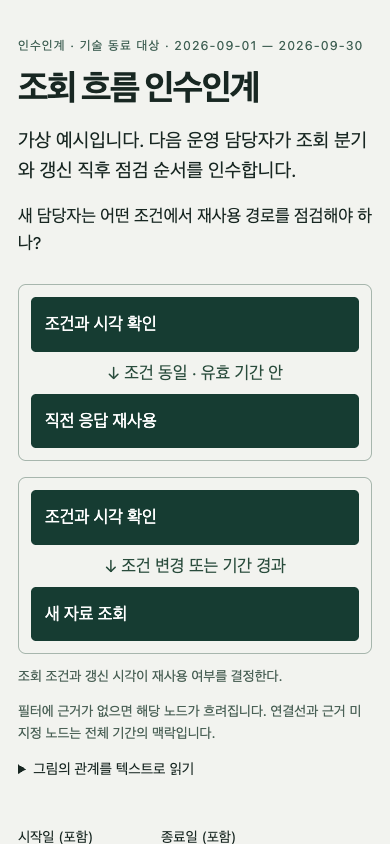

# Work Evidence · 업무 회고와 인수인계

분기 말에 “무엇을 바꿨고, 그 뒤에 무엇을 확인했지?”라는 질문에 답하는 로컬 스킬 두 개입니다. 같은 자료를 다음 담당자에게 넘길 때는 결정 이유, 남은 일, 다음 검증 순서를 중심으로 다시 구성합니다.

| 스킬 | 독자가 할 수 있는 일 |
|---|---|
| `work-timeline` | 기간을 좁혀 작업 흐름과 측정 전후 값을 보고, 항목을 펼쳐 티켓·커밋·위키·지표 근거를 확인합니다. |
| `project-handoff` | 동작 분기를 따라가며 결정 사항, 미해결 작업, 확인 절차와 담당 역할을 읽습니다. 인쇄용 HTML도 함께 생성됩니다. |

[가상 자료로 만든 HTML 샘플 다운로드](https://github.com/1989v/ai/releases/tag/work-evidence-v0.1.0)



## Claude Code에서 시작하기

```text
/plugin marketplace add 1989v/ai
/plugin install work-evidence@ai-common
/reload-plugins
```

```text
/work-evidence:work-timeline 지난 분기의 응답 시간 개선을 회고하고 싶어. 읽을 범위부터 확인해 줘.
/work-evidence:project-handoff 같은 주제를 운영 담당자에게 넘길 문서로 정리해 줘.
```

## Codex에서 시작하기

[두 스킬 디렉터리](skills)를 개인 스킬 경로(`$CODEX_HOME/skills`, 기본 `~/.codex/skills`) 아래에 각각 복사하고 새 세션에서 `$work-timeline` 또는 `$project-handoff`를 호출합니다. 기존에 같은 이름을 설치했다면 변경 내용을 비교한 뒤 업데이트하세요.

## 샘플 재현

Python 3.9 이상과 IANA 시간대 데이터가 있는 환경에서 플러그인 디렉터리를 기준으로 실행합니다. 새 출력 디렉터리를 사용하세요.

```sh
mkdir demo-output
python3 skills/work-timeline/scripts/render.py --input examples/timeline.json --output demo-output/timeline.html
python3 skills/project-handoff/scripts/render.py --input examples/handoff.json --output demo-output/handoff.html --print-output demo-output/handoff-print.html
```

샘플의 날짜·사건·측정값은 모두 가상입니다. 생성된 HTML은 브라우저로 열 수 있고, 파일을 읽거나 필터를 조작할 때 모델 호출이나 외부 서버가 필요하지 않습니다.

## 실제 업무 자료로 실행할 때

1. 회사·개인 구분, 질문, 독자, 기간·시간대, 읽을 소스 및 권한을 먼저 확인합니다. 회사 위키는 선택한 공간·페이지·개정 범위를 지정합니다.
2. 로컬 Git 수집기는 승인된 저장소·작성자·기간의 활동 시점을 추출합니다. Jira, 위키, PR, 운영 지표는 권한 있는 로컬 읽기 경로나 비식별 내보내기를 사용합니다. 연동 방식과 입력 형식은 [수집 안내](skills/work-timeline/references/input.md)에 있습니다.
3. 모델에 전달하기 전에 원문을 최소화하고 민감정보와 개인정보를 제거합니다. 비공개 출처는 별칭으로 표시합니다. 자동 검사는 이메일·비밀키 등의 일부 패턴을 탐지하며, 업무 문맥이 드러나는 표현이나 공개 가능한 수치는 사람이 확인합니다. 실행 중 사용하는 AI 계정과 이용량은 각 사용자의 환경에 따릅니다.
